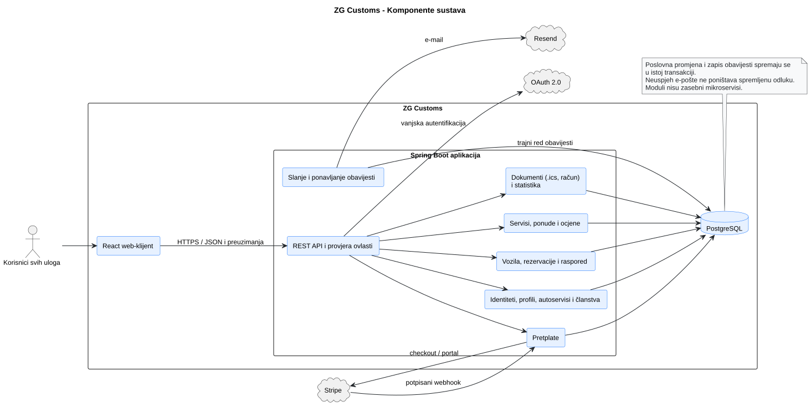
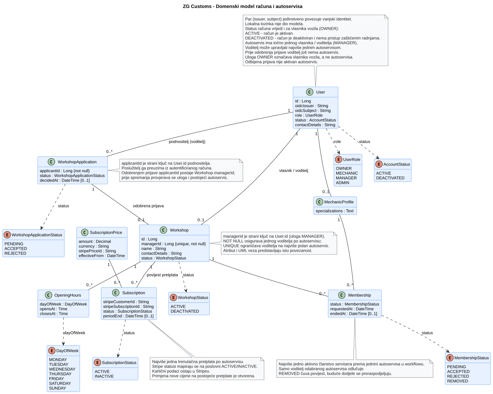
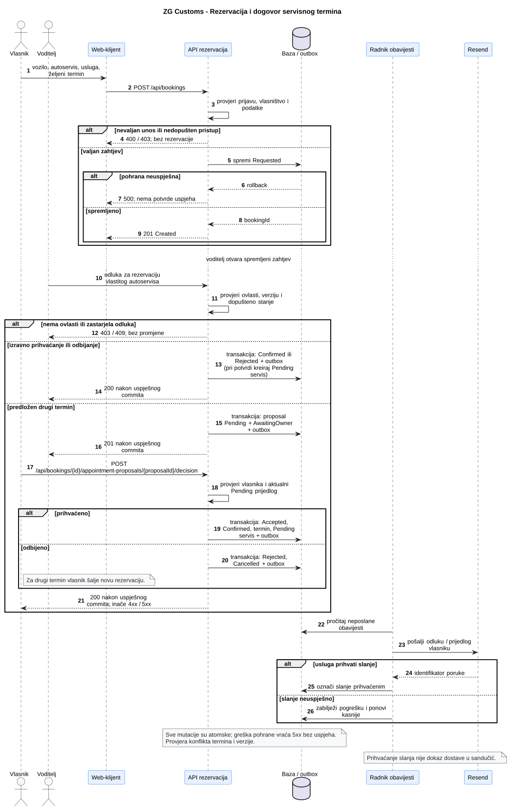
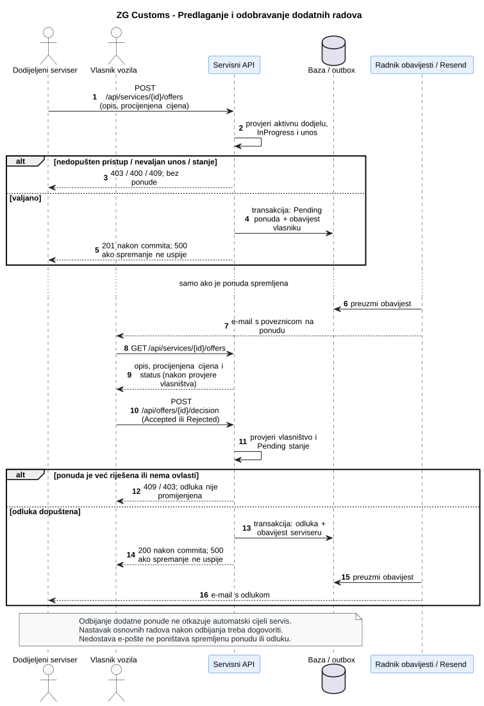
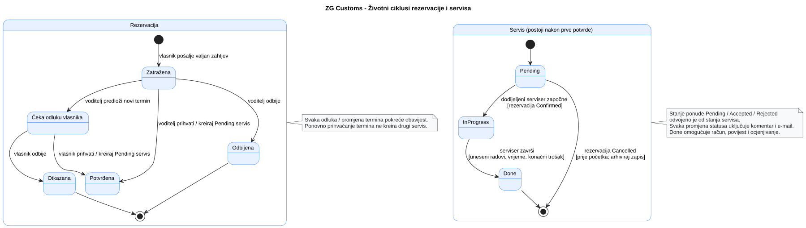
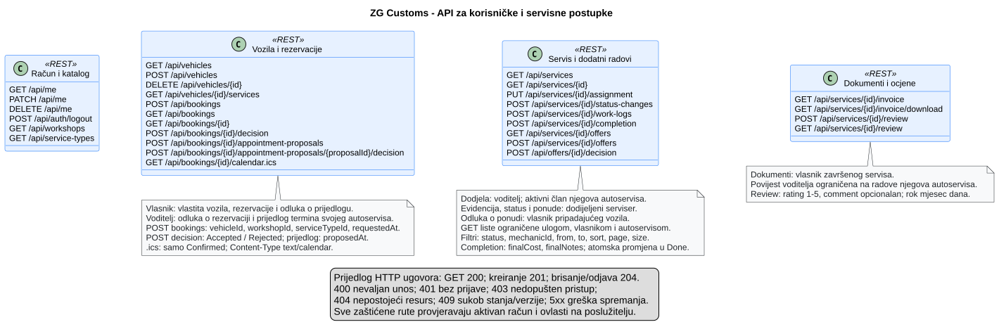
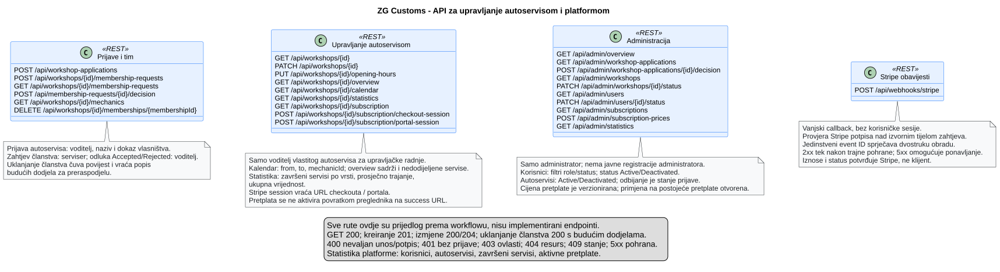

# 4. Arhitektura i oblikovanje

ZG Customs ima React/TypeScript klijent, Spring Boot poslužitelj i PostgreSQL bazu. Implementirana početna inačica dohvaća katalog usluga. Dijagrami poslovne domene predstavljaju planirano proširenje; fizički razmještaj opisan je u [poglavlju 6](6-Postavljanje-instalacija-i-konfiguracija.md).

## 4.1 Ključne arhitekturne odluke

| Postojeće rješenje              | Primjena i posljedice                                                                                     |
| ------------------------------- | --------------------------------------------------------------------------------------------------------- |
| Jedna poslužiteljska aplikacija | Moduli dijele Spring Boot proces i ciklus postavljanja; prikaz komponenti nije mikroservisna arhitektura. |
| Relacijska baza i Flyway        | Verzije sheme prate se migracijama; Hibernate provjerava postojeću shemu.                                 |
| Jedno web-ishodište             | Caddy poslužuje klijent i prosljeđuje relativni `/api` backendu.                                          |
| Docker Compose na jednoj VM     | Tri spremnika dijele domaćina; njegov kvar utječe na cijelu aplikaciju.                                   |

## 4.2 Gradivni blokovi i UML dijagram komponenata

**Slika 4.1. Planirane komponente sustava** — [PlantUML izvor](./puml/4-1-zg-customs-system-CMP.puml).

| Dio                    | Odgovornost i stanje                                                                         |
| ---------------------- | -------------------------------------------------------------------------------------------- |
| Web-klijent            | Implementiran prikaz kataloga, učitavanja i pogreške dohvata. Poslovni obrasci su planirani. |
| API i katalog          | Implementirani ServiceTypeController i ServiceTypeRepository vraćaju kategorije iz baze.     |
| Računi i autoservisi   | Planirani identiteti, uloge, prijave i članstva.                                             |
| Rezervacije i servisi  | Planirani termini, dodjele, radovi, ponude i ocjene.                                         |
| Dokumenti i statistika | Planirani račun, izvoz termina i agregirani pregledi.                                        |
| Pretplate i obavijesti | Planirane integracije Stripea i Resenda.                                                     |

Trajni red obavijesti u dijagramu predstavlja prijedlog transakcijskog outbox obrasca: poslovna promjena i zapis za slanje spremaju se zajedno, a radnik naknadno šalje poruku. Ovaj mehanizam nije implementiran. Potpisani Stripe webhook predviđa provjeru izvora događaja i sprječavanje ponovljene obrade.

## 4.3 Model podataka i oblikovanje razreda

### 4.3.1 ER dijagram i model podataka

Implementirana je tablica `service_types`: `id` je primarni ključ, `code` jedinstven obvezni niz do 32 znaka, `name` obvezan niz do 100 znakova, a `description` do 500 znakova. [Početna migracija](../backend/src/main/resources/db/migration/V1__create_service_types.sql) unosi četiri kategorije.

### 4.3.2 Reprezentativni UML dijagram razreda

**Slika 4.2. Računi, autoservisi i pretplate** — [PlantUML izvor](./puml/4-3-zg-customs-accounts-domain-CD.puml).

Vanjski identitet povezuje se s lokalnim korisnikom parom `oidcIssuer` i `oidcSubject`. Workshop.managerId referencira User.id; obveznost i jedinstvenost ograničavaju autoservis na jednog voditelja i voditelja na najviše jedan autoservis. Prijava sadrži applicantId; autoservis nastaje tek prihvaćanjem prijave. Stoga WorkshopStatus sadrži ACTIVE i DEACTIVATED, dok PENDING pripada prijavi. Članstvo čuva povijest pristupanja i uklanjanja servisera.

Lokalni račun započinje u stanju `UNREGISTERED`. Vlasnik vozila postaje aktivan pri registraciji, a računi servisera i voditelja ostaju `PENDING` do prihvaćanja članstva odnosno prijave autoservisa. OIDC konfiguracija i inicijalno postavljanje administratora opisani su u [uputama za vanjsku prijavu](oidc.md).

U PostgreSQL-u par `users.oidc_issuer` i `users.oidc_subject` jedinstveno povezuje vanjski identitet s lokalnim računom. Uloge se spremaju u `roles` i `user_roles`, a specijalizacije u `users.specializations`. API mapira uloge `CLIENT` i `WORKSHOP_MANAGER` na `OWNER` i `MANAGER`. Tablica `membership_requests` čuva povijest zahtjeva, a `workshop_memberships` prihvaćena članstva.

**Slika 4.3. Rezervacije i servisna evidencija** — [PlantUML izvor](./puml/4-3-zg-customs-service-domain-CD.puml).

Booking predstavlja zahtjev, a AppointmentProposal zamjenski termin o kojem odlučuje vlasnik. ServiceJob nastaje nakon potvrde; Assignment bilježi dodjelu, WorkLog radove i vrijeme, a StatusChange promjene statusa. AdditionalWorkOffer ima zaseban životni ciklus. ServiceDocument predstavlja račun, a Review ocjenu i opcionalni komentar.

User i Workshop u servisnom prikazu imaju manji skup atributa nego u modelu računa; predstavljaju iste domenske pojmove, ne dodatne tablice. Različit zapis kontaktnih podataka u tim prikazima još nije konačan ugovor implementacije. Enum tipovi određuju dopuštene vrijednosti, ali sami ne provode ovlasti ni pravila prijelaza. Od prikazanih entiteta implementiran je [ServiceType](../backend/src/main/java/hr/fer/zgcustoms/servicecatalog/ServiceType.java).

## 4.4 Ponašanje tijekom izvođenja

### 4.4.1 Reprezentativni UML sekvencijski dijagram

**Slika 4.4. Rezervacija i dogovor termina** — [PlantUML izvor](./puml/4-4-zg-customs-booking-SD.puml).

Tijek razrađuje UC-04 i UC-13: unos rezervacije, provjeru vlasništva, odluku voditelja i odgovor vlasnika na novi termin. Pogreška pohrane ne smije rezultirati lažnom potvrdom. Slanje obavijesti slijedi trajnu pohranu promjene.

**Slika 4.5. Dodatni radovi i odluka vlasnika** — [PlantUML izvor](./puml/4-4-zg-customs-additional-work-SD.puml).

UC-11 i UC-08 odvajaju prijedlog servisera od odluke vlasnika. Ponuda se može riješiti samo dok čeka odgovor. Odbijanje dodatnih radova nije automatsko otkazivanje osnovnog servisa.

## 4.5 Zapisi arhitekturnih odluka

Model životnog ciklusa razdvaja dogovor termina od izvođenja servisa. Sljedeće odluke proizlaze iz [PlantUML modela](./puml/4-5-zg-customs-booking-service-SM.puml) i opisuju planirano poslovno ponašanje.

| Odluka | Razlog i posljedica |
| --- | --- |
| Rezervacija i servis imaju zasebne životne cikluse. | Zahtjev može biti odbijen ili otkazan prije radova. Servis nastaje tek prvom potvrdom rezervacije; ponovno prihvaćanje termina ne stvara drugi servis. |
| Zamjenski termin zahtijeva odluku vlasnika. | Prijedlog voditelja prelazi u stanje čekanja; prihvaćanje potvrđuje rezervaciju, a odbijanje je otkazuje. |
| Početak i završetak servisa imaju uvjete. | Dodijeljeni serviser započinje rad uz potvrđenu rezervaciju. Završetak zahtijeva unesene radove, vrijeme i konačni trošak. |
| Ponuda dodatnih radova ima neovisno stanje. | Pending, Accepted i Rejected opisuju ponudu, a ne zamjenjuju stanja servisa Pending, InProgress i Done. |
| Otkazivanje prije početka čuva zapis. | Model predviđa arhiviranje servisa u stanju Pending kada se rezervacija otkaže. Ne definira otkazivanje nakon početka radova. |
| Promjene pokreću obavijesti. | Odluke i promjene termina pokreću obavijest; promjena statusa servisa uključuje komentar i e-poštu putem Resenda. Završetak omogućuje račun, povijest i ocjenjivanje. |

**Slika 4.6. Životni ciklusi rezervacije i servisa** — [PlantUML izvor](./puml/4-5-zg-customs-booking-service-SM.puml).

## 4.6 Zajednička pravila oblikovanja (engl. Cross-cutting concerns)

Implementirani frontend koristi relativni API i prikazuje poruku pri neuspjehu dohvata. Caddy odvaja javne rute od Actuator endpointova; to nije zamjena za buduću autorizaciju poslovnih radnji. Lozinke baze dolaze iz privatne konfiguracije.

Za planirane radnje vrijede poslužiteljska provjera uloge i vlasništva, validacija podataka i atomsko spremanje povezanih promjena. Deaktivirani račun ne smije pristupati zaštićenim radnjama. Identitet podnositelja određuje se iz autentificirane sjednice, ne proizvoljnim korisničkim ID-om iz zahtjeva.

**Slika 4.7. Predloženi korisnički i servisni API** — [PlantUML izvor](./puml/4-6-zg-customs-customer-service-API.puml).

**Slika 4.8. Predloženi upravljački API** — [PlantUML izvor](./puml/4-6-zg-customs-management-API.puml).

### Implementirane API rute

Sljedeće rute definirane su u trenutačnom backend kodu. Popis potvrđuje implementaciju kontrolera, a ne provjeru javnog postavljanja.

| Metoda i putanja | Implementacija |
| --- | --- |
| `GET /api/service-types` | [ServiceTypeController](../backend/src/main/java/hr/fer/zgcustoms/servicecatalog/ServiceTypeController.java) |
| `GET /api/auth/provider` | [OnboardingController](../backend/src/main/java/hr/fer/zgcustoms/accounts/OnboardingController.java) |
| `GET /api/auth/csrf` | [OnboardingController](../backend/src/main/java/hr/fer/zgcustoms/accounts/OnboardingController.java) |
| `GET /api/me` | [OnboardingController](../backend/src/main/java/hr/fer/zgcustoms/accounts/OnboardingController.java) |
| `PATCH /api/me` | [OnboardingController](../backend/src/main/java/hr/fer/zgcustoms/accounts/OnboardingController.java) |
| `POST /api/auth/register` | [OnboardingController](../backend/src/main/java/hr/fer/zgcustoms/accounts/OnboardingController.java) |
| `GET /api/workshops` | [OnboardingController](../backend/src/main/java/hr/fer/zgcustoms/accounts/OnboardingController.java) |
| `POST /api/workshops/{id}/membership-requests` | [OnboardingController](../backend/src/main/java/hr/fer/zgcustoms/accounts/OnboardingController.java) |
| `POST /api/workshop-applications` | [OnboardingController](../backend/src/main/java/hr/fer/zgcustoms/accounts/OnboardingController.java) |
| `GET /api/onboarding/mine` | [OnboardingController](../backend/src/main/java/hr/fer/zgcustoms/accounts/OnboardingController.java) |
| `GET /api/admin/workshop-applications` | [OnboardingController](../backend/src/main/java/hr/fer/zgcustoms/accounts/OnboardingController.java) |
| `GET /api/workshops/{id}/membership-requests` | [OnboardingController](../backend/src/main/java/hr/fer/zgcustoms/accounts/OnboardingController.java) |
| `GET /api/workshops/{id}/mechanics` | [OnboardingController](../backend/src/main/java/hr/fer/zgcustoms/accounts/OnboardingController.java) |
| `POST /api/admin/workshop-applications/{id}/decision` | [OnboardingController](../backend/src/main/java/hr/fer/zgcustoms/accounts/OnboardingController.java) |
| `POST /api/membership-requests/{id}/decision` | [OnboardingController](../backend/src/main/java/hr/fer/zgcustoms/accounts/OnboardingController.java) |
| `DELETE /api/workshops/{id}/memberships/{membershipId}` | [OnboardingController](../backend/src/main/java/hr/fer/zgcustoms/accounts/OnboardingController.java) |
| `GET /api/vehicles` | [VehicleController](../backend/src/main/java/hr/fer/zgcustoms/vehicles/VehicleController.java) |
| `POST /api/vehicles` | [VehicleController](../backend/src/main/java/hr/fer/zgcustoms/vehicles/VehicleController.java) |
| `DELETE /api/vehicles/{id}` | [VehicleController](../backend/src/main/java/hr/fer/zgcustoms/vehicles/VehicleController.java) |

Spring Security dodatno obrađuje `GET /api/auth/login/external`, `GET /api/auth/callback/external` i `POST /api/auth/logout`. Prijava i callback dostupni su uz konfiguriran OAuth 2.0 / OpenID Connect klijent; odjava završava lokalnu sjednicu. Za izmjene podataka koristi se CSRF zaštita. [SecurityConfig](../backend/src/main/java/hr/fer/zgcustoms/accounts/SecurityConfig.java) definira ove rute i pravila pristupa.

Vozila trenutačno podržavaju popis, unos i arhiviranje; ruta za uređivanje vozila nije implementirana. Rute za rezervacije, izvođenje servisa, dodatne ponude, račune, ocjene, statistiku, Resend i Stripe još nisu implementirane u pregledanim kontrolerima. Dijagrami API-ja prikazuju planirani opseg; stanje PENDING odnosi se na prijavu autoservisa, dok odobreni autoservis ima stanje ACTIVE.

## 4.7 Arhitekturni rizici i tehnički dug

| Rizik ili nedovršeni dio                           | Posljedica                                                                                           |
| -------------------------------------------------- | ---------------------------------------------------------------------------------------------------- |
| Jedna VM i lokalne kopije                          | Kvar domaćina može zahvatiti aplikaciju i sigurnosne kopije; vanjska pohrana još nije uspostavljena. |
| Nepostojanje poslovne autorizacije                 | Poslovne rute ne mogu se smatrati spremnima samo zato što infrastruktura radi.                       |
| Neusuglašena pravila brisanja, termina i pretplata | Implementacija i ispitivanja tih rubnih slučajeva ovise o dodatnim odlukama.                         |
| Migracije bez automatskog povrata                  | Vraćanje starog aplikacijskog imagea ne vraća prethodnu shemu baze.                                  |
