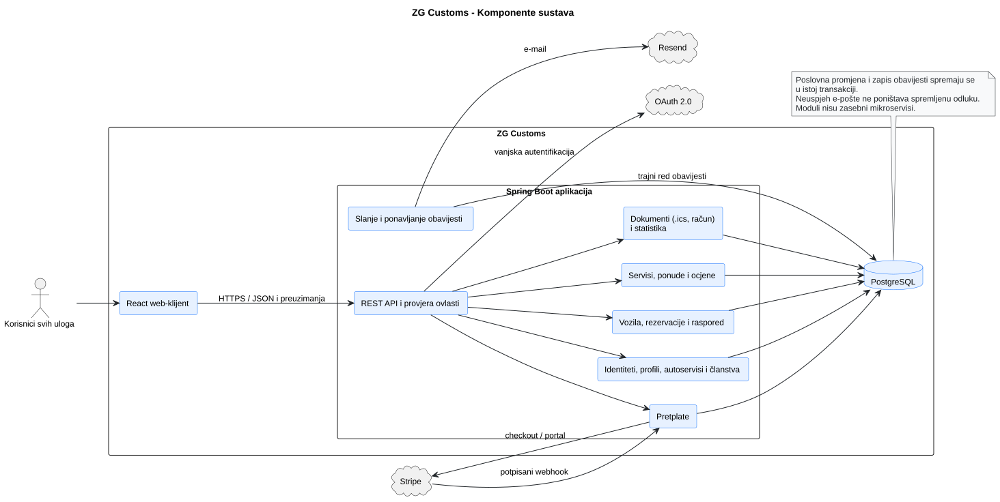
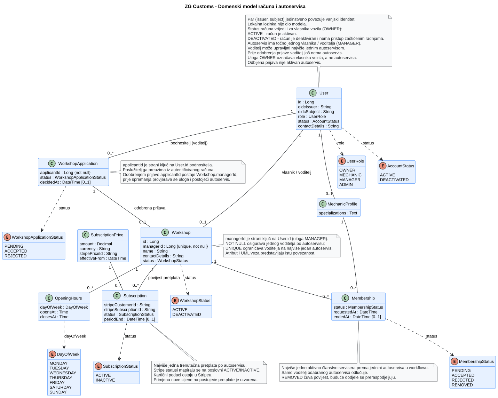
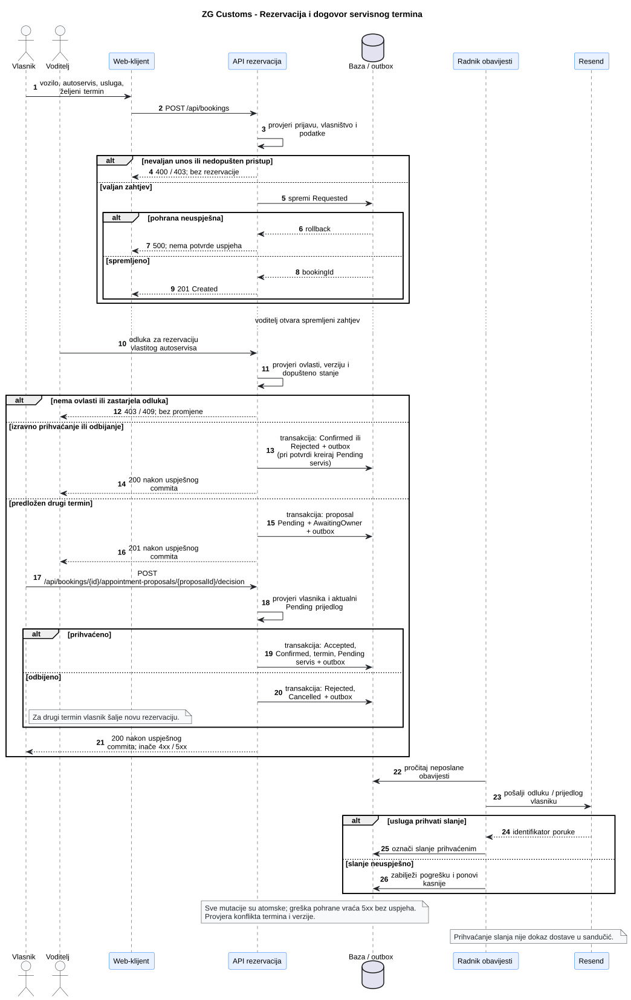
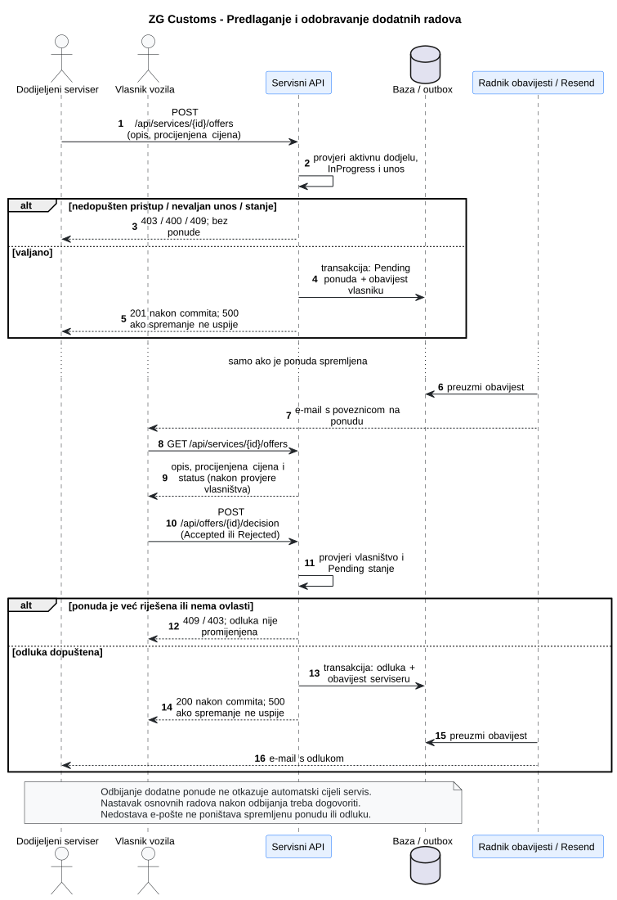
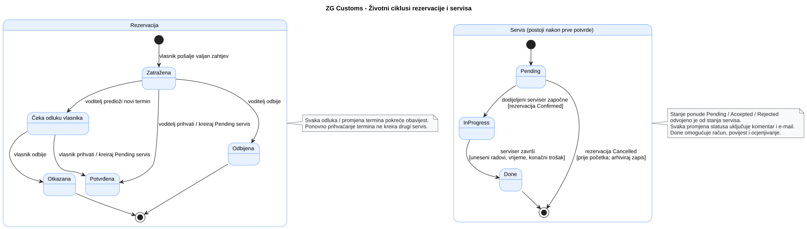
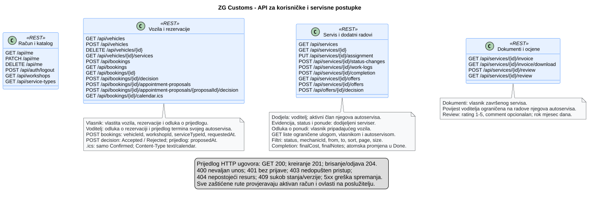
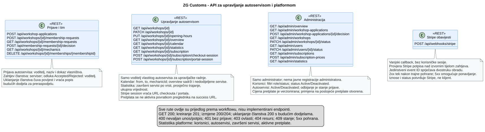

# 4. Arhitektura i oblikovanje

ZG Customs ima React/TypeScript klijent, Spring Boot poslužitelj i PostgreSQL bazu. Implementirana početna inačica dohvaća katalog usluga. Dijagrami poslovne domene predstavljaju planirano proširenje; fizički razmještaj opisan je u [poglavlju 6](6-Postavljanje-instalacija-i-konfiguracija.md).

## 4.1 Ključne arhitekturne odluke

| Postojeće rješenje              | Primjena i posljedice                                                                                     |
| ------------------------------- | --------------------------------------------------------------------------------------------------------- |
| Jedna poslužiteljska aplikacija | Moduli dijele Spring Boot proces i ciklus postavljanja; prikaz komponenti nije mikroservisna arhitektura. |
| Relacijska baza i Flyway        | Verzije sheme prate se migracijama; Hibernate provjerava postojeću shemu.                                 |
| Jedno web-ishodište             | Caddy poslužuje klijent i prosljeđuje relativni `/api` backendu.                                          |
| Docker Compose na jednoj VM     | Tri spremnika dijele domaćina; njegov kvar utječe na cijelu aplikaciju.                                   |

## 4.2 Gradivni blokovi i UML dijagram komponenata

**Slika 4.1. Planirane komponente sustava** — [PlantUML izvor](./puml/4-1-zg-customs-system-CMP.puml).

| Dio                    | Odgovornost i stanje                                                                         |
| ---------------------- | -------------------------------------------------------------------------------------------- |
| Web-klijent            | Implementiran prikaz kataloga, učitavanja i pogreške dohvata. Poslovni obrasci su planirani. |
| API i katalog          | Implementirani ServiceTypeController i ServiceTypeRepository vraćaju kategorije iz baze.     |
| Računi i autoservisi   | Planirani identiteti, uloge, prijave i članstva.                                             |
| Rezervacije i servisi  | Planirani termini, dodjele, radovi, ponude i ocjene.                                         |
| Dokumenti i statistika | Planirani račun, izvoz termina i agregirani pregledi.                                        |
| Pretplate i obavijesti | Planirane integracije Stripea i Resenda.                                                     |

Trajni red obavijesti u dijagramu predstavlja prijedlog transakcijskog outbox obrasca: poslovna promjena i zapis za slanje spremaju se zajedno, a radnik naknadno šalje poruku. Ovaj mehanizam nije implementiran. Potpisani Stripe webhook predviđa provjeru izvora događaja i sprječavanje ponovljene obrade.

## 4.3 Model podataka i oblikovanje razreda

### 4.3.1 ER dijagram i model podataka

Implementirana je tablica `service_types`: `id` je primarni ključ, `code` jedinstven obvezni niz do 32 znaka, `name` obvezan niz do 100 znakova, a `description` do 500 znakova. [Početna migracija](../backend/src/main/resources/db/migration/V1__create_service_types.sql) unosi četiri kategorije. Zaseban projektni ER dijagram nije dostupan; dijagrami razreda u nastavku nisu prikaz implementirane relacijske sheme.

### 4.3.2 Reprezentativni UML dijagram razreda

**Slika 4.2. Računi, autoservisi i pretplate** — [PlantUML izvor](./puml/4-3-zg-customs-accounts-domain-CD.puml).

Vanjski identitet povezuje se s lokalnim korisnikom parom `oidcIssuer` i `oidcSubject`. Workshop.managerId referencira User.id; obveznost i jedinstvenost ograničavaju autoservis na jednog voditelja i voditelja na najviše jedan autoservis. Prijava sadrži applicantId; autoservis nastaje tek prihvaćanjem prijave. Stoga WorkshopStatus sadrži ACTIVE i DEACTIVATED, dok PENDING pripada prijavi. Članstvo čuva povijest pristupanja i uklanjanja servisera.

**Slika 4.3. Rezervacije i servisna evidencija** — [PlantUML izvor](./puml/4-3-zg-customs-service-domain-CD.puml).

Booking predstavlja zahtjev, a AppointmentProposal zamjenski termin o kojem odlučuje vlasnik. ServiceJob nastaje nakon potvrde; Assignment bilježi dodjelu, WorkLog radove i vrijeme, a StatusChange promjene statusa. AdditionalWorkOffer ima zaseban životni ciklus. ServiceDocument predstavlja račun, a Review ocjenu i opcionalni komentar.

User i Workshop u servisnom prikazu imaju manji skup atributa nego u modelu računa; predstavljaju iste domenske pojmove, ne dodatne tablice. Različit zapis kontaktnih podataka u tim prikazima još nije konačan ugovor implementacije. Enum tipovi određuju dopuštene vrijednosti, ali sami ne provode ovlasti ni pravila prijelaza. Od prikazanih entiteta implementiran je [ServiceType](../backend/src/main/java/hr/fer/zgcustoms/servicecatalog/ServiceType.java).

## 4.4 Ponašanje tijekom izvođenja

### 4.4.1 Reprezentativni UML sekvencijski dijagram

**Slika 4.4. Rezervacija i dogovor termina** — [PlantUML izvor](./puml/4-4-zg-customs-booking-SD.puml).

Tijek razrađuje UC-04 i UC-13: unos rezervacije, provjeru vlasništva, odluku voditelja i odgovor vlasnika na novi termin. Pogreška pohrane ne smije rezultirati lažnom potvrdom. Slanje obavijesti slijedi trajnu pohranu promjene.

**Slika 4.5. Dodatni radovi i odluka vlasnika** — [PlantUML izvor](./puml/4-4-zg-customs-additional-work-SD.puml).

UC-11 i UC-08 odvajaju prijedlog servisera od odluke vlasnika. Ponuda se može riješiti samo dok čeka odgovor. Odbijanje dodatnih radova nije automatsko otkazivanje osnovnog servisa.

### 4.4.2 Reprezentativni UML dijagram stanja

**Slika 4.6. Životni ciklusi rezervacije i servisa** — [PlantUML izvor](./puml/4-5-zg-customs-booking-service-SM.puml).

Rezervacija prolazi kroz zahtjev, eventualno čekanje odluke vlasnika i potvrdu, odbijanje ili otkazivanje. Servis ima stanja PENDING, IN_PROGRESS i DONE. Ponovno prihvaćanje termina ne stvara drugi servis. Nazivi u dijagramu stanja prikazni su ekvivalenti enum vrijednosti iz modela razreda. Povratni prijelazi i otkazivanje tijekom radova nisu konačno specificirani.

## 4.5 Zapisi arhitekturnih odluka

## 4.6 Zajednička pravila oblikovanja (engl. Cross-cutting concerns)

Implementirani frontend koristi relativni API i prikazuje poruku pri neuspjehu dohvata. Caddy odvaja javne rute od Actuator endpointova; to nije zamjena za buduću autorizaciju poslovnih radnji. Lozinke baze dolaze iz privatne konfiguracije.

Za planirane radnje vrijede poslužiteljska provjera uloge i vlasništva, validacija podataka i atomsko spremanje povezanih promjena. Deaktivirani račun ne smije pristupati zaštićenim radnjama. Identitet podnositelja određuje se iz autentificirane sjednice, ne proizvoljnim korisničkim ID-om iz zahtjeva.

**Slika 4.7. Predloženi korisnički i servisni API** — [PlantUML izvor](./puml/4-6-zg-customs-customer-service-API.puml).

**Slika 4.8. Predloženi upravljački API** — [PlantUML izvor](./puml/4-6-zg-customs-management-API.puml).

Implementiran je `GET /api/service-types`; ostale poslovne rute predstavljaju prijedlog. Konačne JSON sheme i pravila filtriranja nisu definirani ovim dijagramima. Bilješka upravljačkog API-ja još navodi PENDING za autoservis, što je zastarjelo: čekanje se odnosi na WorkshopApplication.

## 4.7 Arhitekturni rizici i tehnički dug

| Rizik ili nedovršeni dio                           | Posljedica                                                                                           |
| -------------------------------------------------- | ---------------------------------------------------------------------------------------------------- |
| Jedna VM i lokalne kopije                          | Kvar domaćina može zahvatiti aplikaciju i sigurnosne kopije; vanjska pohrana još nije uspostavljena. |
| Nepostojanje poslovne autorizacije                 | Poslovne rute ne mogu se smatrati spremnima samo zato što infrastruktura radi.                       |
| Neusuglašena pravila brisanja, termina i pretplata | Implementacija i ispitivanja tih rubnih slučajeva ovise o dodatnim odlukama.                         |
| Migracije bez automatskog povrata                  | Vraćanje starog aplikacijskog imagea ne vraća prethodnu shemu baze.                                  |
